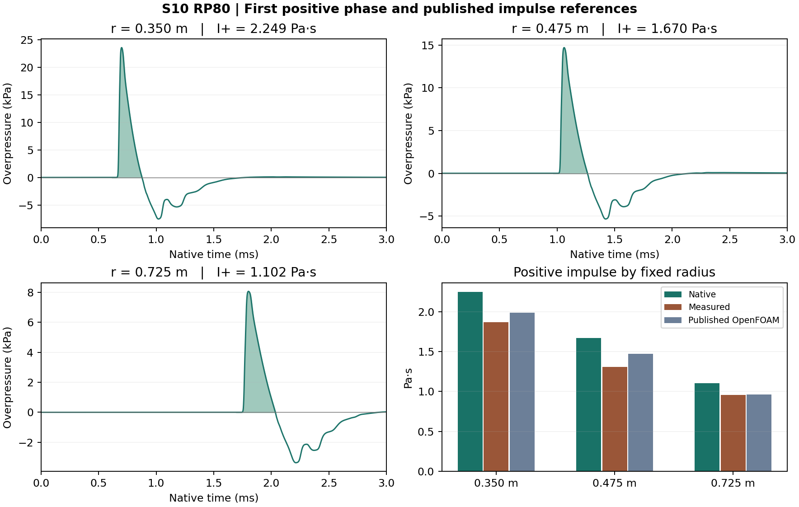

# S10 近地无障碍传播 · 三点正相冲量复核

沿用作业 8953576 完整交付的三个固定半径及 **0–3 ms** 原生压力。Fouchier §3.1 式 (3.1) 把正相冲量定义为首个正相的超压积分。按事前记录的补评规则，以 0.25 kPa 确认首个有效正压波瓣，在波瓣前后用线性插值找过零点，对两点之间的分段线性超压积分。三点均在窗内完整闭合，均包含原已评分峰值。用 0.1 和 0.5 kPa 定位也得到同一波瓣。[积分规则](protocol.json) · [完整作业及原峰值](../job-8953576/index.html) · [图 6.7 实测与论文数值来源](../reference_repeatability_20261107/README.md)

| 半径（m） | 正相窗口（ms） | 本次仿真（Pa·s） | 图 6.7 实测（Pa·s） | 实测 APE | 论文 OpenFOAM APE |
| ---: | ---: | ---: | ---: | ---: | ---: |
| 0.350 | 0.614–0.877 | 2.249 | 1.867 | 20.48% | 13.12% |
| 0.475 | 0.965–1.264 | 1.670 | 1.306 | 27.91% | 13.31% |
| 0.725 | 1.694–2.036 | 1.102 | 0.958 | 14.96% | 14.54% |

正相冲量对图 6.7 实测的条件性 MAPE 为 **21.11%**，对作者 OpenFOAM 为 **13.66%**。按 ±3 px 的图读灵敏度，实测冲量 MAPE 为 **16.79%–25.60%**，0.475 m 的单点范围为 23.34%–32.65%。三点冲量均偏高。按图 6.1 三次 RP80 试验中心值复核，正相冲量 MAPE **21.73%**。实验具体过零处理和图 6.7 聚合口径待核，图读区间单独列示。

首要指标仍为图 6.7 的固定三点峰值，实测 MAPE **3.40%**，三点均达标。同一仿真峰值对图 6.1 三次试验中心值的补充 MAPE 为 **4.94%**。两个图的原值和统计身份分别保留。图 6.8 面板标注及时钟仍待核，绝对到达时间留空。[原文 §3.1](../../../../../../graduation-thesis-materials/graduation-literature/papers/fouchier-urban-dispersion-thesis-2020.pdf#page=29) · [逐点 CSV](impulse_pointwise.csv) · [原生和参考哈希](impulse_review.json)

## 同窗重构对照

迎风基线 8952323 超时，最后原生样本在 2.914 ms。两版三个正相均在共同前缀内闭合。迎风到 van Leer，0.350／0.475／0.725 m 正相持续时间分别由 **0.451／0.563／0.742 ms** 缩短为 **0.263／0.300／0.342 ms**。同窗峰值实测 MAPE 由 **38.77% 降到 3.40%**，冲量诊断 MAPE 则由 **14.12% 升到 21.11%**。重构使首峰更尖、更接近实测峰值，冲量偏高有所增加。迎风版的完整交付仍为失败，补充指标按共同前缀诊断。[迎风压力及峰值报告](../live_job_8953576_terminal_baseline_20261108/index.html) · [两版积分端点、逐点 APE 和原始哈希](reconstruction_impulse_diagnostic.json)
