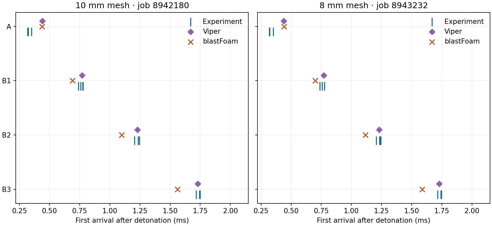

# Gabriel 100% 转角实验 · 到达时间对照

两档独立仿真都完整交付 A、B1、B2、B3 的 0–5 ms 压力时程。实验组取 Gabriel 等表 A1 的 14 条非零到达时间，论文数值组取表 6 的四条同尺度 Viper 到达时间。原表试次 2 的 A 与试次 4 的 B3 缺测，两点仍属于独立仿真的必交测点。[实测原表](../sources/table-a1.png) · [Viper 原表](../sources/tables-5-6.png) · [实验与点位](../index.html)

| C 集群作业 | 传波区目标间距 | 实测到达时间 MAPE（14 项） | Viper 到达时间 MAPE（4 项） |
| --- | ---: | ---: | ---: |
| [8942180](../job-8942180/index.html) | 10 mm | **14.92%** | **7.90%** |
| [8943232](../job-8943232/index.html) | 8 mm | **14.09%** | **6.81%** |

| 测点 | 实测范围（ms） | 10 mm 仿真（ms） | 10 mm 实测 APE 范围 | 8 mm 仿真（ms） | 8 mm 实测 APE 范围 |
| --- | ---: | ---: | ---: | ---: | ---: |
| A | 0.318–0.351 | 0.43764 | 24.68%–37.62% | 0.44258 | 26.09%–39.18% |
| B1 | 0.739–0.776 | 0.68997 | 6.63%–11.09% | 0.69963 | 5.33%–9.84% |
| B2 | 1.205–1.245 | 1.09697 | 8.96%–11.89% | 1.11616 | 7.37%–10.35% |
| B3 | 1.715–1.748 | 1.55968 | 9.06%–10.77% | 1.58708 | 7.46%–9.21% |

以爆轰为时间零点，沿用原核对的 0.5 µs 采样间隔和 5 µs 斜率外推规则，在事前绑定的测点窗口提取到达时间，四点均有结果。源数据核对中，100% 尺度的 14 条实验压力时程均在 10 µs 内复现表 A1 到达时间，最大偏差 7.13 µs。75% 尺度仍有一项超限，暂不汇报其到达时间 MAPE。[源数据核对](../native_c_20261107/arrival_reference_audit.json) · [比较绑定](binding.json)

两档的**到达时间** MAPE 都落入 ≤15% 档，A 点仍晚于全部可用实测。峰值超压另算，两档 A 点的峰值均未通过原固定窗口判据，所以完整峰值 MAPE 留空。此页为已完成原生仿真的补充诊断，入选资格待人工审核。[全部 36 项逐点 APE](comparison.csv) · [独立复算与原生时程哈希](independent_recalculation.json) · [复算脚本](review_arrival.py)
